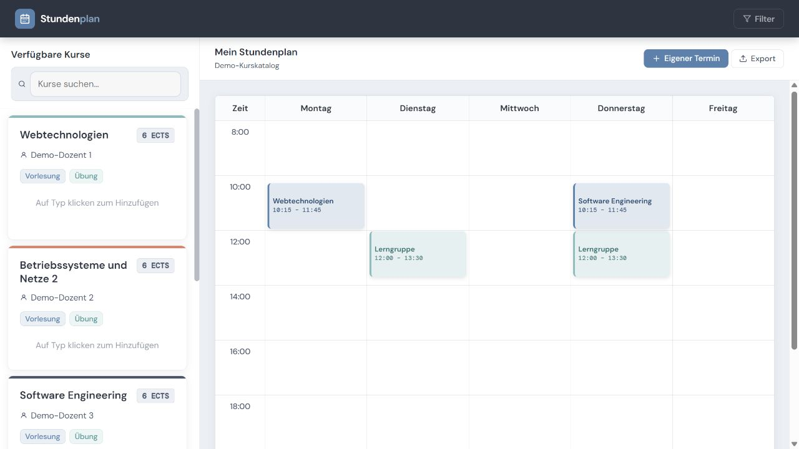

# University Timetable Planner

A web application for building a personal weekly university timetable. Choose course sessions, add custom events, and keep your schedule in your browser.

Built as a **group project for Webtechnologien (summer semester 2026)** using JavaScript, HTML, CSS, Node.js, and Express. The interface is in German.



## Features

- Browse a course catalog with instructors, ECTS credits, and lecture/tutorial options.
- Select a specific session by weekday, time, and room.
- Create, edit, and delete custom events with descriptions, colors, and multiple weekdays.
- View Monday–Friday on an 08:00–24:00 calendar with a 15-minute layout grid; overlapping events appear side by side.
- Search course names by prefix and filter courses by degree program (MDI/BIN).
- Keep selected sessions and custom events across reloads using browser `localStorage`.
- Export the calendar as a PDF or JPG using html2canvas and jsPDF.

## Quick start

Install [Node.js 24 LTS](https://nodejs.org/en/download), which includes npm. Open a terminal in the folder containing `package.json`, then run:

```sh
npm ci
npm start
```

Open **http://localhost:8080**. Stop the server with `Ctrl+C`.

No database, account, API key, or environment file is required. Use the Express server rather than opening `public/index.html` directly: the frontend loads its catalog from `/api/kurse`.

Internet access is needed for the initial dependency installation. Fonts load from Google Fonts; the export libraries load from cdnjs on demand, so PDF/JPG export also needs access to that CDN.

## Using the planner

1. Click **Vorlesung** or **Übung** on a course card, then select a session.
2. Use **Eigener Termin** to add a personal event. Choose weekdays, start/end times, and a color, then click **Speichern**.
3. Click a custom event to edit or delete it. Click a course event for details and its removal button. Right-clicking an event also removes it.
4. Use **Filter** for degree programs or the search box for a course-name prefix.
5. Choose **Export → Als PDF speichern** or **Als JPG speichern** to save an image-based copy of the calendar.

## Technology and design

| Layer | Implementation |
| --- | --- |
| Frontend | HTML, CSS, vanilla JavaScript ES modules |
| Backend | Node.js and Express 5 |
| Course catalog | Local JSON file, served through a read-only HTTP endpoint |
| Personal schedule | Browser `localStorage` under the key `myEvents` |
| Calendar | Table grid with positioned event blocks and overlap calculation |
| Exports | html2canvas 1.4.1 and jsPDF 4.2.1, loaded on demand |
| Typography | DM Sans and DM Mono via Google Fonts |

The server serves the frontend and course catalog. Event creation, rendering, editing, and persistence happen in the browser; personal events are not submitted to a server database.

### API

`GET /api/kurse` returns an array of course objects. The file `data/kurse.json` wraps that array in a `kurse` property. Each course contains its name, degree programs, credits, instructor label, and available sessions.

To customize the catalog, edit `data/kurse.json` and reload the page. Session blocks `1`–`6` map to predefined times in `public/scripts/sidebar.js`.

## Project structure

```text
university-timetable-planner/
├── README.md
├── CREDITS.md
├── .gitignore
├── package.json
├── package-lock.json
├── server.js
├── data/
│   └── kurse.json
├── docs/
│   └── screenshot.png
└── public/
    ├── index.html
    ├── main.js
    ├── style.css
    └── scripts/
        ├── api.js
        ├── calendar.js
        ├── export.js
        ├── filter.js
        ├── search.js
        ├── sidebar.js
        └── text.js
```

## Project context and team

Developed collaboratively for **Webtechnologien, SoSe 2026** by:

- Paria Nourikhah
- Zhina Bagheri
- Mohammad Reza Gholijani
- Mahdi Roustaei Chamkakaei

This repository presents the shared project as a portfolio example. Responsibilities overlapped within the team; it does not attribute the entire implementation to a single contributor.

Original team repository: [uni-schedule-builder on GitLab](https://gitlab.gwdg.de/paria.nourikhah/uni-schedule-builder) (access may be restricted).

The portfolio copy adds documentation and a screenshot, substitutes demo instructor and room labels, escapes dynamic text before HTML insertion, and updates dependency resolutions and the PDF library. The original project archive is preserved separately.

## Demo data and current limitations

- The included catalog contains **5 example courses and 23 session choices**. Instructor and room labels are fictional placeholders. This is not an official university timetable.
- Schedules belong to the current browser and origin. There is no account, cross-device synchronization, or server-side backup; clearing site data removes the saved schedule. Exported PDFs/JPGs cannot be imported as editable schedules.
- The calendar is a fixed weekly view. Semester dates and recurrence labels in the catalog do not drive date-specific scheduling or holiday exceptions.
- Search and degree filtering each refresh the catalog independently; they are not combined filters.
- Event-time validation is basic. Use an end time after the start, within the displayed weekday/time range. Accessibility and small-screen interaction need further work.
- Exports are rasterized images; the PDF does not contain selectable calendar text. Export controls reached their success messages during the local check, but the downloaded PDF/JPG files could not be retrieved for inspection in the test browser.
- This version needs a Node.js server. Uploading the source to GitHub does not deploy a live website, and GitHub Pages alone will not run the Express API.

## Credits and license information

See [CREDITS.md](CREDITS.md) for third-party libraries and fonts. The original package metadata declares `ISC`, but the supplied archive has no standalone license file. That metadata is retained; this portfolio preparation does not add or change a license grant for the group's code.
